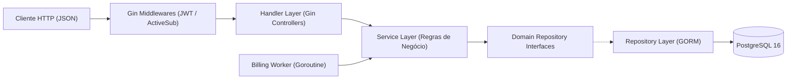
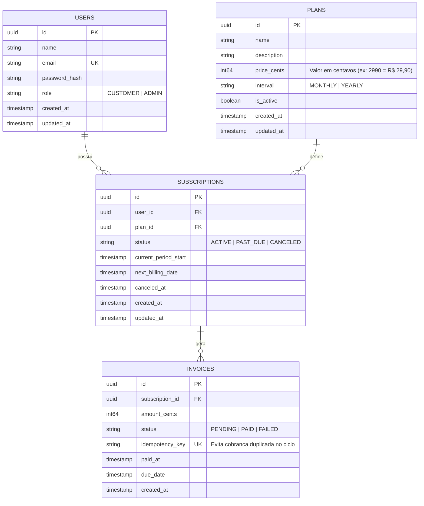
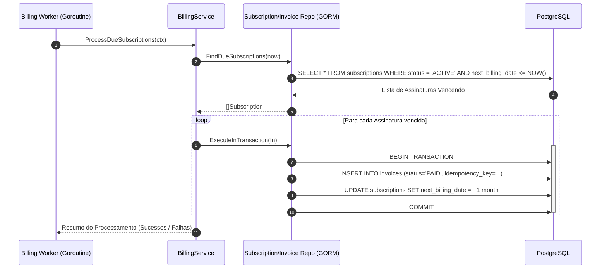

# 🏗️ Documentação de Arquitetura — GoPayments (GoPay)

Este documento detalha as decisões arquiteturais, a modelagem de dados e os fluxos de negócio da API **GoPayments**.

---

## 1. Visão Geral das Camadas (Layered Architecture + Dependency Injection)

A aplicação segue o princípio de **Separação de Responsabilidades (SoC)** e **Inversão de Dependência (DIP)**. Cada camada conversa com a camada inferior através de **Interfaces** definidas no pacote `domain`.

### Responsabilidade de Cada Camada:
1. **`handler` (Apresentação / HTTP):**
   - Recebe o `*gin.Context`, faz o *bind* e validação do JSON (`shouldBindJSON`).
   - Extrai dados do usuário autenticado via contexto do Gin (`user_id`, `role`).
   - Chama o `service` correspondente e traduz erros de domínio para códigos HTTP (`200`, `201`, `400`, `401`, `403`, `404`, `409`, `500`).
2. **`service` (Regras de Negócio / UseCases):**
   - Contém toda a inteligência do negócio (ex: impedir que um usuário tenha duas assinaturas ativas, calcular o `next_billing_date`, orquestrar cobranças).
   - **Não conhece HTTP (Gin) nem SQL direto**, facilitando testes unitários com *mocks*.
3. **`repository` (Infraestrutura / Persistência):**
   - Implementa as interfaces do `domain` utilizando o **GORM**.
   - Gerencia transações atômicas (`db.Transaction`) para garantir que faturas e atualizações de status de assinatura nunca fiquem inconsistentes.
4. **`domain` (Núcleo):**
   - Define as entidades (`User`, `Plan`, `Subscription`, `Invoice`), constantes de status, erros de negócio padronizados e contratos (interfaces).

---

## 2. Modelagem do Banco de Dados (DER)

---

## 3. Decisões Técnicas Importantes (Boas Práticas de Fintech)

### 💰 3.1. Valores Monetários em Centavos (`int64`)
Em sistemas financeiros, **nunca se utiliza `float32` ou `float64`** para representar dinheiro devido a erros de precisão binária IEEE 754 (ex: `0.1 + 0.2 = 0.30000000000000004`).
- No **GoPay**, todos os valores (`price_cents`, `amount_cents`) são armazenados como inteiros de 64 bits (`int64`) representando **centavos**.
- Exemplo: `R$ 49,90` é salvo no banco como `4990`.

### 🔒 3.2. Transações ACID no GORM (`db.Transaction`)
Quando um usuário assina um plano ou quando o Worker processa a renovação mensal, duas tabelas são afetadas (`subscriptions` e `invoices`).
- Se a criação da fatura funcionar, mas a atualização da data de próxima cobrança (`next_billing_date`) falhar, o banco ficaria inconsistente.
- Utilizamos `db.Transaction(func(tx *gorm.DB) error { ... })` para garantir **Atomicidade**: ou tudo é salvo com sucesso (`COMMIT`), ou tudo é desfeito (`ROLLBACK`).

### 🔁 3.3. Idempotência nas Faturas (`idempotency_key`)
Se o Worker de cobrança rodar duas vezes no mesmo segundo por engano, o cliente não pode ser cobrado duas vezes.
- Cada fatura possui uma chave única determinística por ciclo: `sub_<subscription_id>_cycle_<YYYY-MM-DD>`.
- O índice `UNIQUE` no PostgreSQL garante que nenhuma cobrança duplicada seja gerada para o mesmo período.

---

## 4. Fluxo de Cobrança Recorrente (Sequence Diagram)

